# Kool.ad/e architecture atlas

> **18 views · 36 Mermaid diagrams**. Current means present in the October 13, 2026 codebase at the architecture level; Future means target design from the linked GitHub issues. Diagrams deliberately simplify detailed failure and security cases. The source issues and code remain authoritative.

[Explore the interactive gallery](https://kool.ad/diagrams) · [Marketing architecture tour](https://kool.ad/architecture)

## 01. System context

Target specification: [GitHub issue #172](https://github.com/zbarno/kool.ade/issues/172).

### Current architecture (simplified)

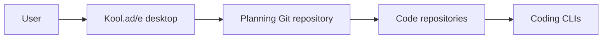

### Future architecture (target)

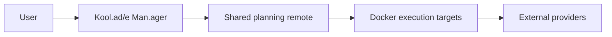

## 02. Controller components

Target specification: [GitHub issue #157](https://github.com/zbarno/kool.ade/issues/157).

### Current architecture (simplified)

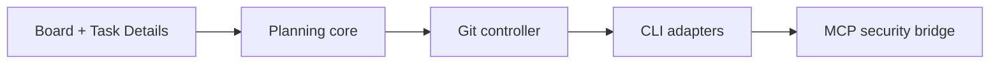

### Future architecture (target)

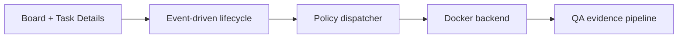

## 03. Agent roles and orchestration

Target specification: [GitHub issue #158](https://github.com/zbarno/kool.ade/issues/158).

### Current architecture (simplified)

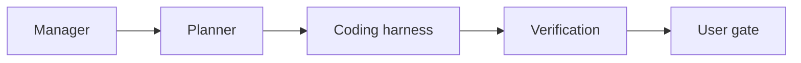

### Future architecture (target)

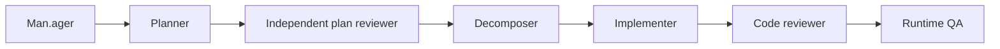

## 04. Feature and task lifecycle

Target specification: [GitHub issue #157](https://github.com/zbarno/kool.ade/issues/157).

### Current architecture (simplified)

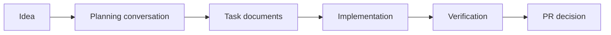

### Future architecture (target)

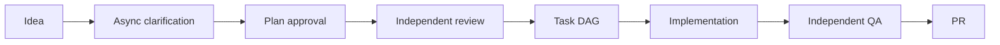

## 05. Planning ambiguity and approval

Target specification: [GitHub issue #159](https://github.com/zbarno/kool.ade/issues/159).

### Current architecture (simplified)

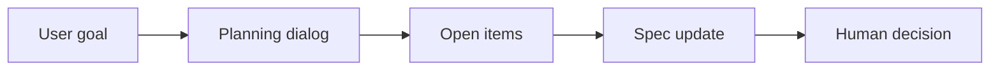

### Future architecture (target)


## 06. Living specification and traceability

Target specification: [GitHub issue #161](https://github.com/zbarno/kool.ade/issues/161).

### Current architecture (simplified)

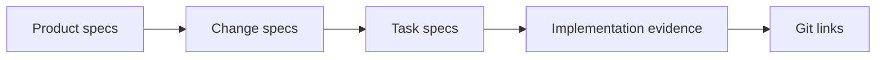

### Future architecture (target)

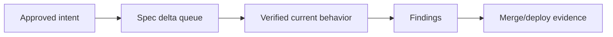

## 07. Shared planning and multi-user

Target specification: [GitHub issue #121](https://github.com/zbarno/kool.ade/issues/121).

### Current architecture (simplified)

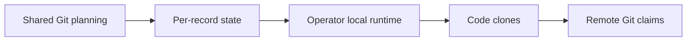

### Future architecture (target)

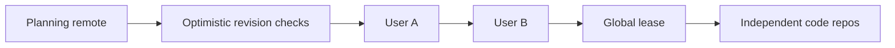

## 08. Task DAG and clones

Target specification: [GitHub issue #162](https://github.com/zbarno/kool.ade/issues/162).

### Current architecture (simplified)

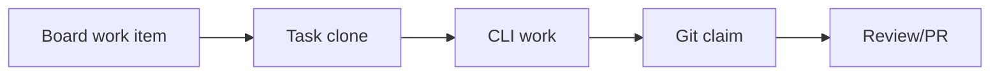

### Future architecture (target)

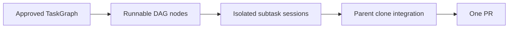

## 09. Local execution and sandbox

Target specification: [GitHub issue #136](https://github.com/zbarno/kool.ade/issues/136).

### Current architecture (simplified)

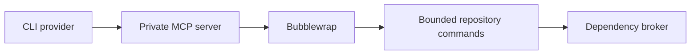

### Future architecture (target)

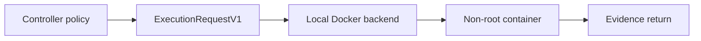

## 10. Remote execution parity

Target specification: [GitHub issue #139](https://github.com/zbarno/kool.ade/issues/139).

### Current architecture (simplified)

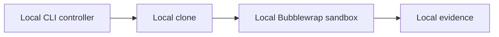

### Future architecture (target)

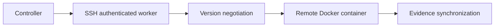

## 11. MCP and security boundaries

Target specification: [GitHub issue #156](https://github.com/zbarno/kool.ade/issues/156).

### Current architecture (simplified)

```mermaid
flowchart LR
    c0["CLI tool"]
    c1["Private MCP bridge"]
    c2["Scoped tool access"]
    c3["Bubblewrap"]
    c4["Application Git publisher"]
    c0 --> c1
    c1 --> c2
    c2 --> c3
    c3 --> c4
```

### Future architecture (target)

```mermaid
flowchart LR
    f0["CLI tool"]
    f1["Application policy boundary"]
    f2["Docker command bridge"]
    f3["Brokered resources"]
    f4["Controller Git publisher"]
    f0 --> f1
    f1 --> f2
    f2 --> f3
    f3 --> f4
```

## 12. Independent review and QA

Target specification: [GitHub issue #166](https://github.com/zbarno/kool.ade/issues/166).

### Current architecture (simplified)

```mermaid
flowchart LR
    c0["Implementation diff"]
    c1["Unit tests"]
    c2["Validation report"]
    c3["Human PR approval"]
    c0 --> c1
    c1 --> c2
    c2 --> c3
```

### Future architecture (target)

```mermaid
flowchart LR
    f0["Implementation diff"]
    f1["Independent code review"]
    f2["Desktop/browser QA"]
    f3["Finding"]
    f4["Repair"]
    f5["Fresh review"]
    f0 --> f1
    f1 --> f2
    f2 --> f3
    f3 --> f4
    f4 --> f5
```

## 13. PR, merge and delivery truth

Target specification: [GitHub issue #164](https://github.com/zbarno/kool.ade/issues/164).

### Current architecture (simplified)

```mermaid
flowchart LR
    c0["Task clone"]
    c1["Verification"]
    c2["PR preparation"]
    c3["Git remote"]
    c4["Board state"]
    c0 --> c1
    c1 --> c2
    c2 --> c3
    c3 --> c4
```

### Future architecture (target)

```mermaid
flowchart LR
    f0["Verified parent diff"]
    f1["Controlled PR"]
    f2["Merged code"]
    f3["Spec reconciliation"]
    f4["Deployment evidence"]
    f0 --> f1
    f1 --> f2
    f2 --> f3
    f3 --> f4
```

## 14. Persistence and telemetry

Target specification: [GitHub issue #161](https://github.com/zbarno/kool.ade/issues/161).

### Current architecture (simplified)

```mermaid
flowchart LR
    c0["Git planning"]
    c1["Operator conversations"]
    c2["Implementation records"]
    c3["Token ledger"]
    c4["Task report"]
    c0 --> c1
    c1 --> c2
    c2 --> c3
    c3 --> c4
```

### Future architecture (target)

```mermaid
flowchart LR
    f0["Planning remote"]
    f1["Immutable approvals"]
    f2["Local event ledger"]
    f3["Evidence manifest"]
    f4["Cost report"]
    f0 --> f1
    f1 --> f2
    f2 --> f3
    f3 --> f4
```

## 15. UI conversations and attention

Target specification: [GitHub issue #165](https://github.com/zbarno/kool.ade/issues/165).

### Current architecture (simplified)

```mermaid
flowchart LR
    c0["Board"]
    c1["Task Details"]
    c2["Task thread"]
    c3["Needs Attention"]
    c4["Specification chat"]
    c0 --> c1
    c1 --> c2
    c2 --> c3
    c3 --> c4
```

### Future architecture (target)

```mermaid
flowchart LR
    f0["Board projections"]
    f1["Question card"]
    f2["Approval card"]
    f3["QA review"]
    f4["PR card"]
    f5["Spec status"]
    f0 --> f1
    f1 --> f2
    f2 --> f3
    f3 --> f4
    f4 --> f5
```

## 16. Evolve and self-improvement

Target specification: [GitHub issue #174](https://github.com/zbarno/kool.ade/issues/174).

### Current architecture (simplified)

```mermaid
flowchart LR
    c0["Observed friction"]
    c1["Manual enhancement idea"]
    c2["User task"]
    c3["Implementation"]
    c4["PR"]
    c0 --> c1
    c1 --> c2
    c2 --> c3
    c3 --> c4
```

### Future architecture (target)

```mermaid
flowchart LR
    f0["Event observations"]
    f1["Opportunity proposal"]
    f2["Explicit opt-in"]
    f3["Isolated implementation"]
    f4["QA"]
    f5["Reviewed PR"]
    f0 --> f1
    f1 --> f2
    f2 --> f3
    f3 --> f4
    f4 --> f5
```

## 17. Stack-neutral extensibility

Target specification: [GitHub issue #173](https://github.com/zbarno/kool.ade/issues/173).

### Current architecture (simplified)

```mermaid
flowchart LR
    c0["User repo"]
    c1["Detected project metadata"]
    c2["Configured CLI"]
    c3["Explicit tests"]
    c4["Verification"]
    c0 --> c1
    c1 --> c2
    c2 --> c3
    c3 --> c4
```

### Future architecture (target)

```mermaid
flowchart LR
    f0["Capability detection"]
    f1["Unknown technology"]
    f2["Approval request"]
    f3["Extension implementation"]
    f4["Build/test/start recipes"]
    f0 --> f1
    f1 --> f2
    f2 --> f3
    f3 --> f4
```

## 18. Integrated happy path

Target specification: [GitHub issue #172](https://github.com/zbarno/kool.ade/issues/172).

### Current architecture (simplified)

```mermaid
flowchart LR
    c0["User input"]
    c1["Planning"]
    c2["Task clone"]
    c3["Agent implementation"]
    c4["Verification"]
    c5["PR"]
    c0 --> c1
    c1 --> c2
    c2 --> c3
    c3 --> c4
    c4 --> c5
```

### Future architecture (target)

```mermaid
flowchart LR
    f0["Goal"]
    f1["Questions"]
    f2["Approval"]
    f3["Plan review"]
    f4["Task DAG"]
    f5["Docker workers"]
    f6["Review and runtime QA"]
    f7["PR and spec sync"]
    f0 --> f1
    f1 --> f2
    f2 --> f3
    f3 --> f4
    f4 --> f5
    f5 --> f6
    f6 --> f7
```
