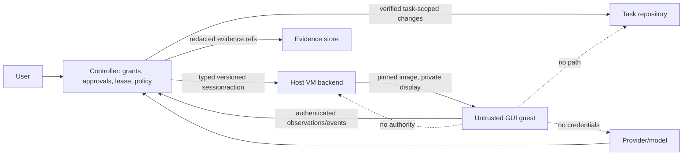
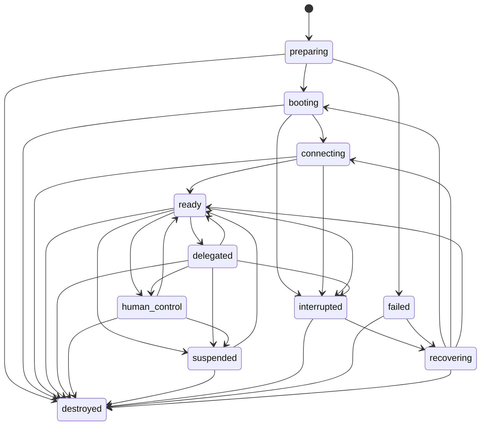

# Computer Use architecture decision and contracts (v1)

Status: proposed interface for CU-01. No VM worker or guest transport is wired
to this contract yet. A later backend must enforce these checks before each
operation; merely deserializing a contract does not authorize a session.

## Decision

Computer Use will use a distinct, typed VM session authority. It will not extend
Docker `ExecutionSession`, Runtime QA driver sessions, or the existing provider
MCP bridge. Docker coding remains rootless and network-disabled by default;
Runtime QA keeps its restricted preview origins; Computer Use will target
QEMU/KVM Linux guests through a future app-owned controller and authenticated
guest companion. The controller owns user grants, task binding, approvals,
lease issuance, network policy, evidence retention, host resource limits, and
repository/workspace changes. Guests return observations and action results;
they cannot commit, push, publish Git, or alter authoritative workspace state.

This separation is required because these workloads have different authorities:

| Workload | Primary authority | Network | Writable state | Who applies results |
| --- | --- | --- | --- | --- |
| Task Docker execution | Controller policy for approved repository tools | Disabled except explicit QA service ports | Task workspace scope | Controller under task claim |
| Runtime QA | Controller-owned QA scenario and isolated driver | Restricted local preview origins | Disposable QA state | QA evidence pipeline |
| Computer Use VM | Explicit user/task grant and lease | Disabled by default; separately granted profile | Disposable overlay; future personal storage requires separate consent | Controller only |

## Trust boundaries

The guest, all applications, accessibility trees, screenshots, web pages,
downloads, and guest-reported status are untrusted. The local worker and its
VM handles are owned by the app controller. QEMU runs as the same logged-in,
unprivileged OS account that runs Kool.ad/e; v1 adds no system account, root
service, or host-admin grant. The guest uses a separate non-root application
identity. Protected host paths include the user home, SSH material, Docker
socket, application configuration and secret state, planning data, and code
repositories. No host home, Docker socket, SSH agent, device passthrough,
arbitrary host path, shell string, hypervisor argv, provider credential, or
cloud token crosses the guest contract. Image trust, guest-channel
authentication, lifecycle cleanup, and network enforcement are backend
obligations, not claims made by this schema.

## Contract summary

`src/computer_use/contract` defines the v1 wire values. All records deny unknown
fields; enum variants are closed; each top-level contract has an explicit
version. `ComputerIdentityV1` binds project, task, user, and session UUIDs.
`ComputerTargetV1` currently describes only local KVM. `ComputerSessionV1`
binds the immutable image digest, class, network profile, app allowlist,
controller-issued policy and lease, lifecycle, action/cancellation/approval
generations, and evidence references. No host path or arbitrary launch command
is representable.

The full session authority payload is signed with Ed25519 by the controller.
The signing key remains in trusted host storage and is never sent to a model,
guest, repository, or worker. A host accepts a session only after
`validate_for_host` succeeds with a public key selected by signer key ID from
its trusted registry. The signature uses the domain prefix
`koolade.computer-session.v1\0` followed by compact UTF-8 JSON with object keys
lexicographically sorted. It covers identity, target, image, policy, lease,
generations, lifecycle, and evidence references. The test fixture signature is
synthetic; it is not a trusted release key.

`ComputerPolicyV1` models the ordered capability ceiling:

1. `offline_disposable_read_only`
2. `approved_gui_task`
3. `internet_research`
4. `persistent_personal`
5. `high_impact_external_action`

This ordering supports comparison only. Promotion always requires a new
controller-issued user grant and approval generation. `restrict_to` intersects
app and operation sets, chooses the lower capability/network profile, and
lowers every resource quota. A task grant does not imply account authority.
Model output cannot mint or renew leases, increase generations, grant
credentials, choose an image, or change the host target. V1 does not define a
transaction authorization mechanism: high-impact actions remain unavailable
until a later policy contract can bind approval to the current exact
destination and transaction details.
The `persistent_personal` and `high_impact_external_action` values are present
to make the capability lattice explicit, but v1 policy validation rejects
them. Persistent sessions need the separate encryption/key contract; high
impact actions need an exact transaction grant. Approved internet is only a
declared grant here and must remain unusable until the #386 network gateway is
implemented and verified.

`ComputerActionV1` has a lease-scoped monotonic action sequence, idempotency
key, controller-authenticated actor (`agent` or `human`), approval and
cancellation generations, typed operation, and closed action payload. The
ingress must derive the authenticated actor from its trusted caller context and
call `validate_as`; the serialized actor field is never identity proof. The
controller appends `action_accepted` to its journal only after this check. The
agent can act only in `delegated`; the human can act only in `human_control`.
Text input is for ordinary task text only; it is not a secret-entry channel.
Human-only protected secret entry is a separate future interface.
`ComputerObservationV1` carries display bounds, content digest, and opaque
evidence references rather than host file paths or inline secrets.
`ComputerEventV1` is sequenced and generation-fenced by
`ComputerEventValidator`. An unacknowledged external side effect is `uncertain`,
which interrupts delegation; it must not be retried automatically. Lease
renewal is controller-only, monotonically fenced, and bounded to fifteen
minutes per issue. A controller-authorized cancellation advances the fence
and interrupts the session. Every action and event carries the active lease
generation so a delayed message from a superseded lease is rejected.
`action_accepted` is a controller-authored journal event, never a guest
assertion. Guest completion, observation, and heartbeat messages remain
untrusted until the authenticated companion transport in CU-05 binds them to
the session and the controller validates their sequence. The caller must
append accepted events durably before acknowledging them and replay that
trusted journal after restart; this contract does not define a serialized
validator checkpoint or a durable store.

## Lifecycle

Allowed edges are validated by `can_transition`; all unlisted edges fail
closed. `destroyed` is terminal. Recovery is explicit and moves through
`recovering`; a lost guest does not become ready merely because a transport
reconnects. Each accepted event must be checked against session identity,
contiguous event sequence, lease generation, action sequence, approval
generation, cancellation generation, and controller state.

## Greenfield implementation plan

1. CU-01 freezes contracts, authority boundaries, lifecycle and threats.
2. CU-02 probes Linux/KVM and reports typed readiness without mutating host
   state; CU-03 builds and verifies the pinned guest image.
3. CU-04 implements only local QEMU/KVM lifecycle, bounded overlays and cleanup
   against these contracts.
4. CU-05 authenticates a minimal guest companion; CU-06 adds generic GUI
   actions/observations; CU-07 adds the app-owned provider-neutral grant path.
5. Viewer/takeover, safe artifact bridge, controlled internet and personal
   sessions remain separately gated issues. High-impact approvals require exact
   action binding and must not be inferred from this v1 grant.
6. CU-16 provides real-host security and release evidence. Unit fixtures and
   CI cannot establish VM escape resistance or real KVM behavior.

## Validation boundary

`tests/fixtures/computer_use/contracts-v1.json` is a language-neutral JSON
fixture. The `computer_use_wire_contract` integration test crosses the public
Rust API/serde boundary, checks canonical re-encoding, and rejects unknown
security fields. It also signs a session with a deterministic test-only key,
then confirms that changing the image invalidates the attestation. Unit tests
exercise policy narrowing, bounds, and lifecycle edges. These tests need no Docker, KVM, SSH, or network service and have low
setup cost. They prove data contract behavior only; a real VM trust-boundary
test belongs to the integrated release suite and remains deferred.
