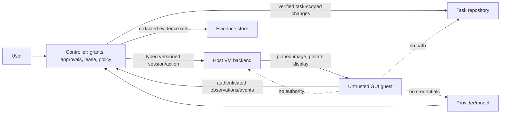
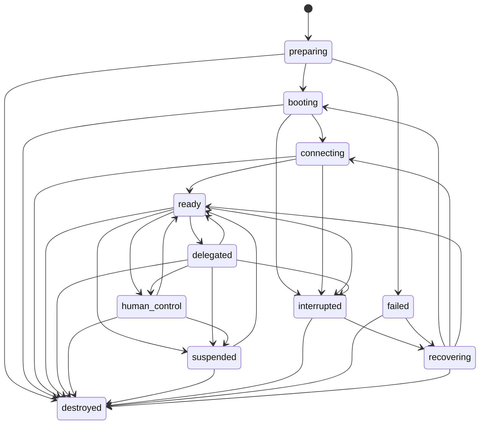

# Computer Use architecture decision and contracts (v1)

Status: the v1 contracts, bounded Linux QEMU/KVM lifecycle, and authenticated
guest transport are implemented. The backend verifies signed sessions and
overlays, runs offline disposable guests under delegated cgroup limits,
authenticates the guest companion before readiness, and recovers only recorded
owned processes. The candidate image remains unpromoted pending separate real
host and catalog acceptance.

## Decision

Computer Use will use a distinct, typed VM session authority. It will not extend
Docker `ExecutionSession`, Runtime QA driver sessions, or the existing provider
MCP bridge. Docker coding remains rootless and network-disabled by default;
Runtime QA keeps its restricted preview origins; Computer Use targets QEMU/KVM
Linux guests through an app-owned controller and authenticated guest companion.
The controller owns user grants, task binding, approvals,
lease issuance, network policy, evidence retention, host resource limits, and
repository/workspace changes. Guests return observations and action results;
they cannot commit, push, publish Git, or alter authoritative workspace state.

This separation is required because these workloads have different authorities:

| Workload | Primary authority | Network | Writable state | Who applies results |
| --- | --- | --- | --- | --- |
| Task Docker execution | Controller policy for approved repository tools | Disabled except explicit QA service ports | Task workspace scope | Controller under task claim |
| Runtime QA | Controller-owned QA scenario and isolated driver | Restricted local preview origins | Disposable QA state | QA evidence pipeline |
| Computer Use VM | Explicit user/task grant and lease | Disabled by default; separately granted profile | Disposable overlay; future personal storage requires separate consent | Controller only |

## Trust boundaries

The guest, all applications, accessibility trees, screenshots, web pages,
downloads, and guest-reported status are untrusted. The local worker and its
VM handles are owned by the app controller. QEMU runs as the same logged-in,
unprivileged OS account that runs Kool.ad/e. The guest uses a separate
non-root application identity; a narrowly scoped root one-shot imports the
per-boot fw_cfg into a guest runtime directory before the companion starts.
Protected host paths include the user home, SSH material, Docker
socket, application configuration and secret state, planning data, and code
repositories. No host home, Docker socket, SSH agent, device passthrough,
arbitrary host path, shell string, hypervisor argv, provider credential, or
cloud token crosses the guest contract. Guest-channel authentication uses a
fresh per-boot secret, nonce challenge, transcript-bound HKDF key, and
HMAC-authenticated typed envelopes. The backend marks readiness only after
the host verifier completes that handshake.

## Image provenance decision

Only an app-owned trusted image catalog may select a guest image. A model,
task, or user supplied digest is never an image selection. CU-03 owns a
versioned signed manifest containing each immutable image digest, target
architecture, guest release, source/recipe revision, and build-attestation
reference. The manifest signer is a release key pinned by the signed Kool.ad/e
application distribution; key rotation requires a signed application update.
The build must publish provenance tied to the exact resulting digest.

Before launching, the host verifier checks the manifest signature against the
pinned release key, its schema and architecture, and that the requested image
digest is an exact catalog entry. The controller issues a session only for
that verified entry. `ComputerSessionV1` binds the image digest, manifest
digest, and manifest signer key ID into its controller signature; the host
also rechecks the manifest before launch. A valid controller signature alone
does not establish image provenance. Missing, revoked, mismatched, or
unverifiable manifest evidence fails closed. Session evidence may reference
the verification receipt, but the receipt cannot substitute for manifest
verification. CU-03 defines the concrete manifest/build-attestation format;
CU-04 consumes it without network discovery or unsigned-image fallback.

## Contract summary

`src/computer_use/contract` defines the v1 wire values. All records deny unknown
fields; enum variants are closed; each top-level contract has an explicit
version. `ComputerIdentityV1` binds project, task, user, and session UUIDs.
`ComputerTargetV1` currently describes only local KVM. The Linux backend accepts
only disposable, offline sessions, fixed QEMU arguments, app-owned overlays,
and a delegated cgroup v2 subtree. It rejects root execution and hosts without
the required KVM, QEMU, or resource controls. `ComputerSessionV1`
binds the immutable image digest and approved manifest identity, class,
network profile, app allowlist,
controller-issued policy and lease, lifecycle, action/cancellation/approval
generations, the immutable session start time, and evidence references. The
session-wide elapsed-time budget remains anchored to that start time across
lease renewal. No host path or arbitrary launch command is representable.

The full session authority payload is signed with Ed25519 by the controller.
The signing key remains in trusted host storage and is never sent to a model,
guest, repository, or worker. A host accepts a session only after
`validate_for_host` succeeds with a public key selected by signer key ID from
its trusted registry. The signature uses the domain prefix
`koolade.computer-session.v1\0` followed by compact UTF-8 JSON with object keys
lexicographically sorted. It covers identity, target, image digest, approved
manifest digest and signer identity, policy, lease, generations, lifecycle,
and evidence references. The test fixture signature is
synthetic; it is not a trusted release key.

`ComputerPolicyV1` models the ordered capability ceiling:

1. `offline_disposable_read_only`
2. `approved_gui_task`
3. `internet_research`
4. `persistent_personal`
5. `high_impact_external_action`

This ordering supports comparison only. Promotion always requires a new
controller-issued user grant and approval generation. `restrict_to` intersects
app and operation sets, chooses the lower capability/network profile, and
lowers every resource quota. A task grant does not imply account authority.
Model output cannot mint or renew leases, increase generations, grant
credentials, choose an image, or change the host target. V1 does not define a
transaction authorization mechanism: high-impact actions remain unavailable
until a later policy contract can bind approval to the current exact
destination and transaction details.
The `persistent_personal` and `high_impact_external_action` values are present
to make the capability lattice explicit, but v1 policy validation rejects
them. Persistent sessions need the separate encryption/key contract; high
impact actions need an exact transaction grant. Approved internet is only a
declared grant here and must remain unusable until the #386 network gateway is
implemented and verified.

`ComputerActionV1` has a lease-scoped monotonic action sequence, idempotency
key, controller-authenticated actor (`agent` or `human`), approval and
cancellation generations, typed operation, and closed action payload. The
ingress must derive the authenticated actor from its trusted caller context and
call `validate_as`; the serialized actor field is never identity proof. The
controller appends `action_accepted` to its journal only after this check. The
agent can act only in `delegated`; the human can act only in `human_control`.
Text input is for ordinary task text only; it is not a secret-entry channel.
Human-only protected secret entry is a separate future interface.
`ComputerObservationV1` carries display bounds, content digest, and opaque
evidence references rather than host file paths or inline secrets.
`ComputerEventV1` is sequenced and generation-fenced by
`ComputerEventValidator`. An unacknowledged external side effect is `uncertain`,
which interrupts delegation; it must not be retried automatically. Lease
renewal is controller-only, monotonically fenced, and bounded to fifteen
minutes per issue. A controller-authorized cancellation advances the fence
and interrupts the session. Every action and event carries the active lease
generation so a delayed message from a superseded lease is rejected.
`action_accepted` is a controller-authored journal event, never a guest
assertion. Guest completion, observation, and heartbeat messages remain
untrusted until the authenticated companion transport binds them to the
session and the controller validates their sequence. The caller must
append accepted events durably before acknowledging them and replay that
trusted journal after restart; this contract does not define a serialized
validator checkpoint or a durable store.

The guest action protocol supports bounded screenshots, window summaries,
pointer actions, keyboard actions, allowlisted application launch, waits, and
state queries. Screenshots carry a session-bound frame ID, monotonic revision,
display generation, pixel dimensions, device scale, compressed PNG, and SHA-256.
Pointer requests bind coordinates to that exact frame and observed window bounds;
the host and guest both reject stale references. Keyboard text uses X11 key
events, including temporary server keyboard mappings for Unicode, and never
uses the clipboard. Application launch uses a fixed in-guest catalog and the
session allowlist; request data cannot supply executable paths or arguments.
Accessibility-tree requests return a typed unsupported result in v1, so callers
must use screenshot and window observations with reduced confidence. The
candidate guest image is still unpromoted; these controls do not establish real
guest-image or cross-toolkit runtime acceptance.

## Lifecycle

Allowed edges are validated by `can_transition`; all unlisted edges fail
closed. `destroyed` is terminal. Recovery is explicit and moves through
`recovering`; a lost guest does not become ready merely because a transport
reconnects. Each accepted event must be checked against session identity,
contiguous event sequence, lease generation, action sequence, approval
generation, cancellation generation, and controller state.

### Local QEMU backend

`computer_use::ComputerBackend` exposes typed probe, prepare, recover, boot,
readiness, connect, suspend, resume, snapshot, cancel, stop, collect, and release
operations. `LocalKvmComputerBackend` accepts only a signed disposable session
with networking disabled and a verified overlay under the configured private
root. It uses a fixed `/usr/bin/qemu-system-x86_64` executable and app-built
arguments; it supplies no guest NIC, host mount, monitor, serial console,
clipboard, or shell. The guest control stream uses one private virtio-serial
socket and remains untrusted until `LocalKvmComputerBackend::authenticate_guest`
completes the challenge-response handshake.

The host must be an unprivileged Linux user with accessible `/dev/kvm`, a
root-owned QEMU binary, and a delegated cgroup v2 subtree with CPU, memory, and
process controllers enabled. The process enters that cgroup before QEMU execs;
memory, CPU, swap, process count, overlay file size, boot time, and signed
session lifetime are bounded. Runtime owner records bind the process start
time, session, lease, image provenance, and overlay path. Restart recovery
stops only matching recorded QEMU processes and removes their owned disposable
overlays. This host backend does not authenticate the guest protocol or verify
VM escape resistance; real KVM security evidence remains a separate release
validation task.

## Provider MCP boundary

Provider access is an optional app-issued `ComputerUseMcpAccessV1` attached to
one planning invocation. The app binds the caller identity, actor, and role;
MCP arguments cannot supply task, user, role, VM, lease, or policy fields. The
private application bridge exposes eight typed tools for capability discovery,
session request/start, observation, action, pause, resume, and release. It
accepts only a private socket below the MCP session directory, bounds request
and response sizes, and returns screenshot bytes as an MCP image block rather
than duplicating them in text.

Every tool call is handed to the app-owned host dispatcher with the immutable
caller identity and cooperative cancellation flag. The dispatcher must resolve
the requested session against current app authority and recheck identity, role,
VM, lease generation, expiry, supported action, resource budget, revocation,
and approval policy on every call, including calls after a provider reconnect.
The bridge reports typed blocked outcomes in task activity. No access object
means no Computer Use tools. Non-Unix hosts fail closed. The controller remains
responsible for creating an approved host dispatcher and presenting session
permissions and revocation in the product UI; this provider bridge does not
create VM sessions or elevate policy.

The schema/parser parity test checks the fixed tool surface for all six CLI
providers. A Unix socket integration test exercises the app-to-host boundary
and blocked activity path without Docker, QEMU, SSH, or network setup. These
fixtures do not claim real guest or KVM validation; the integrated VM test
remains part of the separate release acceptance suite.

## Private file, artifact, and clipboard bridge

`computer_use::artifacts::ComputerArtifactBridgeV1` is the controller-side
staging boundary for `TaskArtifactToGuest`, `GuestArtifactToTask`,
`UserApprovedFileToPersonalGuest`, and `UserDownloadFromGuest`. Grants bind an
exact task/session identity, task revision, normalized relative path, byte
limit, expiry, lease generation, approval generation, transfer purpose, and
whether the operation followed a user approval. Grants are one-use. The
bridge stores bytes and manifests under the installation-local operational
store, outside task clones and Git repositories, with a 64 MiB per-file limit
and a 1 GiB aggregate staging quota. Manifest receipts expose metadata only;
callers fetch bytes separately after rechecking identity and current task
revision/generations. Task files are read without following symbolic links,
reject hard links and Git/private credential paths, and are staged only after
the exact source revision is checked. Guest results remain private staged
artifacts until the task controller applies them under its existing task
claim fencing.

Guest download/export grants require explicit user approval and export to a
user-selected path without overwriting an existing file. Clipboard sharing
has no default grant. A clipboard grant is one-use, identity-bound, at most
five minutes, limited to 64 KiB of UTF-8 text, and carries a visible-indicator
requirement. Clipboard contents are never persisted. Revocation blocks later
reads/exports and removes staged blob bytes; expiry cleanup removes stale
records. `UserApprovedFileToPersonalGuest` remains disabled until the separate
encrypted-personal-session contract is implemented.

The bridge never extracts ZIP archives. ZIP content stays an opaque bounded
blob; consumers must not decompress it without their own expanded-size and
entry-count limits. TAR and gzip/TGZ contents are inspected before staging;
links, device entries, unsafe paths, excessive entries, and expanded content
above the file limit are rejected. No screenshot, download, cookie, or private
task artifact is written to the code repository or published documentation.

The current automated bridge tests cross local grant persistence, task-file
staging, digest verification, revision/generation checks, one-use clipboard,
Unicode case-collision checks, revocation and explicit export. They use a
temporary local application store and task checkout, with no external service.
They do not exercise an authenticated VM file transport or the desktop file
chooser; real VM transfer remains a #392 integration acceptance.

## Greenfield implementation plan

1. CU-01 freezes contracts, authority boundaries, lifecycle and threats.
2. CU-02 probes Linux/KVM and reports typed readiness without mutating host
   state; CU-03 builds and verifies the pinned guest image.
3. CU-04 implements the local QEMU/KVM lifecycle, bounded overlays and cleanup
   against these contracts; real-host validation remains separate.
4. The authenticated guest protocol and companion bind typed actions,
   observations, replay protection, and readiness to a per-boot identity;
   UI product actions and provider grant paths remain separate work.
5. Viewer/takeover, safe artifact bridge, controlled internet and personal
   sessions remain separately gated issues. High-impact approvals require exact
   action binding and must not be inferred from this v1 grant.
6. CU-16 provides real-host security and release evidence. Unit fixtures and
   CI cannot establish VM escape resistance or real KVM behavior.

## Validation boundary

`tests/fixtures/computer_use/contracts-v1.json` is a language-neutral JSON
fixture. The `computer_use_wire_contract` integration test crosses the public
Rust API/serde boundary, checks canonical re-encoding, and rejects unknown
security fields. It also signs a session with a deterministic test-only key,
then confirms that changing the image or approved manifest identity invalidates
the attestation. Unit tests
exercise policy narrowing, bounds, and lifecycle edges. These tests need no Docker, KVM, SSH, or network service and have low
setup cost. They prove data contract behavior only; a real VM trust-boundary
test belongs to the integrated release suite and remains deferred. Backend
unit tests also inspect the fixed QEMU argument and environment boundary; the
overlay launch test uses a fake qemu-img tool to detect changed base images and
backing chains without starting a VM. Neither substitutes for disposable guest
testing on a non-root Linux host with KVM and delegated cgroups.
