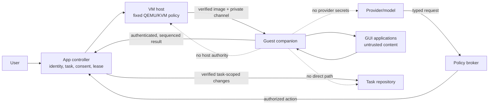
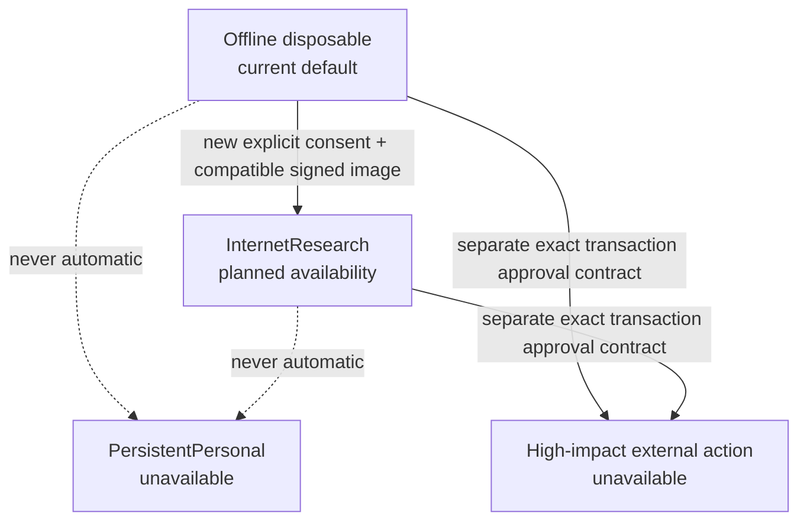
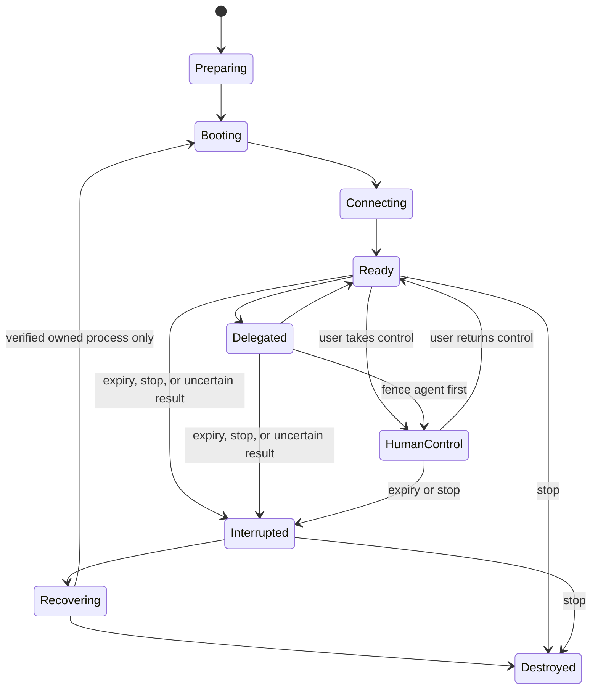

# Computer Use: architecture, permissions, and operating guide

Status checked: 2026-11-10, repository revision `c04a0d8b`.

This page explains the Computer Use product boundary and current support status.
The detailed wire and host contracts remain in [Computer Use architecture
v1](computer-use-architecture-v1.md), the [threat model](computer-use-threat-model-v1.md),
the [guest image guide](computer-use-guest-images-v1.md), and the [readiness
guide](computer-use-readiness-v1.md). The open [end-to-end acceptance issue
#392](https://github.com/zbarno/kool.ade/issues/392) tracks the remaining real-host
and release evidence. A merged implementation or green fixture suite does not
close that release gate.

## Plain-language status

Use these terms consistently in the app, help, and release notes:

| Status | Meaning to an operator |
| --- | --- |
| **Ready** | This exact build and host have current positive evidence for the requested operation, and the app can still deny it when policy, identity, or approval checks fail. It does not guarantee that an account or external site is safe. |
| **Experimental** | The feature has an implementation, but release acceptance or supported-host evidence is incomplete. Use only with synthetic data and an explicit test decision. |
| **Unavailable** | This build or host cannot perform the operation. A permission request, provider response, or manual setting cannot override the missing prerequisite. |

These labels describe capability status, not authorization. A **Ready** machine
still needs an exact task grant, human consent when required, a current lease,
and an approved operation. Unknown, stale, or missing evidence must not be
described as Ready.

As of the revision above, the boundary is:

| Capability | Current status | Evidence and limits |
| --- | --- | --- |
| Typed Computer Use session contracts, controller authority, action/event fencing, and threat model | Implemented | See the v1 architecture and the test names linked from the threat model. Contract tests do not prove VM isolation. |
| Local disposable GUI VM | **Experimental** | The app contains a signed x86_64 guest catalog and local QEMU/KVM path. Host readiness requires current QEMU/KVM, storage, image signature, generation-floor, and cache checks. Real KVM security and usability acceptance remains open in #392. |
| Signed guest image | Ready as a published artifact; runtime remains host-gated | The catalog and lock in `containers/computer-use/` pin a promoted x86_64 image. Its availability does not make unsupported hosts ready. |
| Offline disposable session | Experimental and conditional on current host readiness | Offline is the default network policy. The guest is still untrusted and any host action remains controller-mediated. |
| Internet research guest | **Unavailable** | The published companion protocol is v1 and the app does not offer this network profile for that image. The separately implemented gateway is not permission to browse with the current guest. |
| Task-approved guest application staging and launch | **Experimental** | Implemented behind explicit consent by merged [#394](https://github.com/zbarno/kool.ade/issues/394). Computer QA dispatch, independent evidence, and repair-loop integration remains open in [#389](https://github.com/zbarno/kool.ade/issues/389); this does not clear real-host acceptance in #392. |
| Persistent personal VM and human login | **Unavailable** | The encrypted profile and consent foundation merged in [PR #571](https://github.com/zbarno/kool.ade/pull/571), but [#387](https://github.com/zbarno/kool.ade/issues/387) remains open. The production R3 gate stays disabled until security and human-login validation are accepted. |
| Remote VM workers | **Unavailable for supported use** | The separately enrolled worker implementation merged in [PR #572](https://github.com/zbarno/kool.ade/pull/572), but [#390](https://github.com/zbarno/kool.ade/issues/390) remains open pending independent hosted worker verification and release acceptance. |
| macOS, Windows, Linux arm64 VM hosts | **Unavailable** | The current v1 host claim is x86_64 Linux without nested virtualization. Native unsigned CI packages do not establish VM support. |
| Production Runtime QA | **Unavailable** | The QA profiles remain disabled by their reviewed image policy; see [Runtime QA operations](runtime-qa-operations.md). Computer Use sessions and QA driver sessions have separate authority. |

Do not use a VM as a promise that a logged-in account is protected. A browser
inside a VM can still act as the account that is signed in. Running a browser
also does not mean the site has authorized automation. Do not enter passwords,
payment information, recovery codes, or other secrets into a Computer Use
session. Do not use experimental sessions on personal accounts or valuable
data.

## Architecture and authority

The app controller is the authority boundary. Providers can ask for a typed
capability or operation; they cannot select a host path, VM image, arbitrary
command, account, credential, or network route. The policy broker checks the
task and user grant. The Linux VM host launches the verified image with fixed
arguments and resource limits. The guest companion authenticates the per-boot
channel and reports typed observations and outcomes. A guest result is evidence,
not an instruction to change a repository. The controller applies any accepted
task artifact under the ordinary task/repository fences.



The VM session is separate from task Docker execution and Runtime QA:

| Workload | Authority | Network policy | State and result owner |
| --- | --- | --- | --- |
| Task coding | Approved repository-task capability and task claim | Rootless Docker policy; disabled unless a specific service exception is granted | Isolated task clone; controller validates and applies changes |
| Runtime QA | Approved QA request, target, and evidence lifecycle | Restricted preview origins; production profiles remain unavailable while policy is disabled | Disposable QA state; QA evidence pipeline |
| Computer Use | User/task grant, approval generation, and current lease | Offline disposable guest by default | Disposable guest overlay; controller owns evidence and repository changes |
| InternetResearch | Separate explicit profile, only after compatible image and release gates | Intended public HTTPS-only egress; opaque TLS; not currently offered by the published v1 image | Disposable guest, no inherited credentials |
| PersistentPersonal | Separate identity, encryption, and human-authentication contract | Separate policy required | Not available; no automatic promotion from task sessions |



The arrows describe separate authorization decisions, not automatic upgrades.
No model, task, or guest can promote a session. `restrict_to` can only remove
apps, operations, network access, and quota. A task artifact grant does not
grant access to an account or authorize an external transaction.

## Permission and consent summary

Before starting a session, the interface should show a plain-language summary
for the exact task and exact request. It must not rely on a generic “Computer
Use is enabled” switch. Present:

- **What will start:** task name and revision, guest/image identity, session
  duration, memory/CPU/disk/action budgets, and the apps that can launch.
- **Network:** “Offline” when the guest has no network. If a future profile is
  available, identify its exact network limits and explain that HTTPS contents
  are opaque to the gateway. Never describe a public web tunnel as site
  authorization.
- **Files:** the exact task-relative paths or user-selected export destination
  covered by any artifact grant. Say “No host files are shared” when that is
  true. A task artifact grant never means the guest can browse the host.
- **Recording and evidence:** whether screenshots or activity summaries will
  be captured, where evidence remains, and the applicable retention behavior.
  Do not imply that private input hides content from the guest application.
- **Cleanup and interruption:** what disposable state will be deleted at stop,
  what evidence remains, and how to pause the agent, take control, return
  control, revoke access, or stop the VM.

The current consent request displays the target, role, requested operations,
allowed apps, network profile, and resource budget. The session panel exposes
pause/take-control/return-control/stop actions and warns when an action result
is uncertain. Do not call the permission flow complete for a profile unless
the file, evidence, cleanup, and interruption details above are available for
that profile. Missing details block start.

The app distinguishes a **capability request** from **human approval**. The
model may request an operation; it cannot approve it. Approval must bind the
exact task/session, operation, target, and current approval generation. A
stale, expired, revoked, or uncertain action does not get an automatic retry.

### User control and leases

Control belongs to one actor at a time. The controller fences agent actions
before changing ownership. A human takeover moves the session into human
control; returning control requires a new explicit action. Pause, revoke,
expiry, and stop fence later requests. Every action is tied to the current
session and lease generation; a delayed action from an old generation is
rejected.



If a side effect may have occurred but its result was lost, the UI shows
**Outcome uncertain**. The agent stays paused. The user can inspect the result
or destroy the session; the app does not press the button again automatically.

```mermaid
sequenceDiagram
  participant U as User
  participant C as Controller
  participant B as Policy broker
  participant G as Guest
  U->>C: Approve exact task/session/action
  C->>B: Validate consent, identity, lease, generations
  B->>C: Authorized typed action
  C->>G: Fenced action + idempotency key
  G-->>C: Result or connection loss
  alt authenticated result received
    C-->>U: Record outcome and evidence reference
  else result cannot be determined
    C-->>U: Outcome uncertain; agent remains paused
    Note over C,G: Never retry an uncertain external side effect
  end
```

## Operator path and examples

### Example: test an application's UI

Use a disposable test project and non-sensitive account. The intended workflow
is: open the task, confirm the task revision and allowed app, review the offline
permission summary, approve the exact session, watch the agent use the app,
take control when needed, and inspect the recorded outcome. The controller
keeps authoritative source changes outside the guest. A task-approved build
can be staged and launched through the explicit, grant-bound #394 path. This
does not complete the independent Computer QA scenario/evidence/repair flow in
#389 or the real-host acceptance gate in #392; do not treat an app launch alone
as a QA pass.

### Example: research a public website

This operation is **Unavailable** for the current signed guest image. The
future InternetResearch profile is intended for public HTTPS research only.
Its gateway cannot inspect encrypted paths, methods, forms, or page actions.
That profile would not authorize login, scraping contrary to site terms,
submission, purchase, or any other sensitive action. Do not work around the
current block by copying a host browser session or credentials into the VM.

### Example: resume a personal computer

This operation is **Unavailable**. The persistent-personal issue #387 is still
open, and its own policy keeps persistent identity and credentials disabled
until the R3 security and human-login validation is complete. Encrypted disk
work in an unmerged PR is not shipped support. Never treat a task grant or
disposable session as personal-account authorization.

## Privacy, data, networking, and retention

The controller stores task/session records and evidence in private
installation-local storage, not in the task Git repository. The guest does
not receive the host home directory, Docker socket, SSH agent, repository path,
provider credential, or cloud token. File transfer is a separate typed,
bounded, path-specific grant; no default clipboard bridge exists. Guest output
is staged privately and is applied to source only by the controller under its
task ownership checks.

The offline profile has no guest network interface. A local gateway's presence
does not make networking usable: the app must also verify that the signed image
advertises the compatible companion protocol and the release checks pass. The
current catalog entry advertises protocol v1; InternetResearch is not offered
for it. When the future research profile is enabled, its intended contract is
public HTTPS through a host-resolved, address-filtered tunnel. TLS is opaque,
so the system cannot inspect or prevent a user or application from submitting
an external action inside that tunnel.

Session journals retain bounded metadata and evidence references, not raw
action payloads or credentials. Screenshots and task artifacts have their own
evidence/staging records; operators must review the profile's exact retention
summary before approval. Do not claim a universal retention period or automatic
expiry for Computer Use evidence unless the specific store implements it.
Clipboard values are not persisted. Private input hides viewer/journal content
for the supported path but does not prevent the guest app from reading what was
typed.

## Failure and recovery

| What you see | Meaning | Operator action |
| --- | --- | --- |
| **Unavailable** | A required platform, image, storage, or release prerequisite is missing or explicitly unsupported. | Keep the operation blocked. Capture the current readiness finding and wait for the owner-approved prerequisite. |
| **Experimental** | Implementation exists, but release or host validation is incomplete. | Use only with synthetic data and explicit test approval. Preserve the run and its limits. |
| **Starting** | The controller is preparing the verified image and bounded resources. | Wait for readiness; do not issue agent actions during setup. |
| **Interrupted** | Lease expiry, cancellation, process loss, or another fence stopped delegation. | Review the lifecycle record. Reauthorization must use a fresh request; never reuse stale grants. |
| **Outcome uncertain** | The action might have completed, but its result was not authenticated or journaled. | Keep the agent paused. Inspect the result or destroy the session; do not retry automatically. |
| **Ready** | Current local evidence supports this exact operation. | Review permissions and consent again before each new task/session. Readiness is not approval. |

The backend recovers only VM processes whose ownership record, process start
time, session, lease, image, and overlay still match. A recovery failure does
not authorize killing a process by name or deleting an unowned disk. Preserve
the session ID, task ID/revision, readiness generation, status, and relevant
evidence IDs for diagnosis; do not copy private screenshots or session data
into public issues.

## Desktop QA and web QA are separate

Computer Use provides an interactive guest-session authority. Runtime QA uses
an independently approved target/scenario, isolated driver, preview relay,
reviewer, image policy, and evidence pipeline. A Computer Use session cannot
satisfy a QA release gate. A QA driver cannot inherit Computer Use permissions
or a personal login. Production browser and desktop QA profiles remain
**Unavailable** while their image-lock `runtime_enabled` flags are false.
See [Runtime QA operations](runtime-qa-operations.md) and the [release
evidence](runtime-qa-release-evidence.md).

## Roadmap and platform design

| Path | State | Next gate |
| --- | --- | --- |
| Linux x86_64 local QEMU/KVM, offline disposable guest | Experimental | Complete and merge #392's real-host security, lifecycle, consent, recovery, and release evidence before any Ready/general-availability claim. |
| Linux x86_64 InternetResearch | Unavailable | Compatible signed companion/image, exact network-consent UX, and #392 egress/SSRF/secret-canary tests. |
| Linux arm64 host | Unavailable | Image and supported host backend plus architecture-specific validation; an arm64 native Kool.ad/e package is not a VM backend. |
| macOS or Windows host VM | Unavailable; planned | Separate native virtualization backend, reviewed host boundary, image compatibility, and real-host security acceptance. Do not infer support from unsigned desktop packages. |
| Optional microVM isolation | Planned research | Select a reviewed runtime only after a threat-model comparison, lifecycle/ownership tests, and measured compatibility. It cannot silently replace QEMU. |
| Guest GPU acceleration | Planned research | Define a narrow device policy and validate isolation, driver provenance, reset/recovery, and information-flow implications before enabling passthrough. |
| Separately enrolled remote VM worker | Implementation merged; #390 open | Independent hosted worker verification and release acceptance remain outstanding. Do not treat the implementation as supported production capability. |
| Persistent personal VM | Unavailable; #387 open | The encrypted profile foundation merged in #571, but R3 security, protected credentials, exact human login, isolation, and takeover acceptance remain outstanding. Keep the production gate disabled. |
| Task-approved app install/launch | Experimental; #394 closed | Signed package/catalog and controller-authenticated one-use staging/launch path are implemented. Computer QA dispatch/evidence integration remains in #389; no generic installer command is exposed. |

Development may use rootless container GUI fixtures for deterministic
integration tests. A container shares the host kernel and is not the guest VM
boundary. General availability requires evidence on the real supported VM
host, with the exact signed image, actual isolation, resource controls,
network-denial tests, interruption/recovery, consent, and evidence retention.
No container GUI smoke run is a substitute for that evidence.

## Canonical references and evidence

- [CU-01 threat matrix](computer-use-threat-model-v1.md) maps threats to
  regression tests and the open real-host release gate.
- [CU-03 guest image lifecycle](computer-use-guest-images-v1.md) records the
  signed catalog, image digest, promotion evidence, and host support claim.
- [Readiness probe boundary](computer-use-readiness-v1.md) describes what each
  local setup scan can and cannot prove.
- [v1 architecture and typed tools](computer-use-architecture-v1.md) defines
  the wire schemas, session lifecycle, policy, and backend boundary.
- [Runtime QA operations](runtime-qa-operations.md) documents the independent
  web/desktop QA pipeline and its disabled production profiles.
- [#393 acceptance](https://github.com/zbarno/kool.ade/issues/393) owns this
  onboarding, permissions, and roadmap documentation work.
- [#392 release acceptance](https://github.com/zbarno/kool.ade/issues/392)
  must remain open while real-host security evidence is incomplete.

The document is dated and tied to a tested repository revision so status claims
can be audited. Update its state table when a release flag, signed catalog,
host support claim, or owning issue changes; do not infer status from an open
PR or passing compilation.
