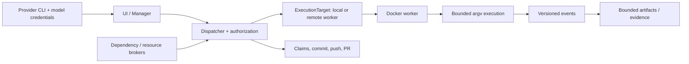

# Execution architecture v1

This document and the `src/execution` types define the shared contract for
future local and remote Docker execution. This issue adds interfaces and
validation only. Existing Bubblewrap execution remains the active runtime;
no new container path is enabled.



The controller owns user approval, provider CLI and model credentials,
dependency/resource authorization, task claims, branch selection, Git
commits, pushes, and pull requests. Provider model transport remains on the
controller. The worker executes only approved repository tools and QA
commands; it never receives provider credentials, task-claim authority, Git
publication credentials, raw Docker API configuration, or a Docker socket.
A disconnected worker cannot renew a claim or publish code. A failed policy
or environment check is a denial, never permission to run a host command.

## Request and target

`ExecutionRequestV1` is a versioned JSON-compatible value. It contains
canonical execution, project, and task UUIDs; an `ExecutionTarget` and its
target ID; a `WorkspaceRef` keyed by project ID, task ID, and pinned source
SHA; one `ExecutionModeV1`; an immutable image digest; argv as an array; names
of permitted environment variables; resource limits; a deadline; QA-only
service ports; broker capability IDs; cancellation generation; and a
monotonic request sequence. The schema has no host path, credential value,
Docker socket address, raw `HostConfig`, free-form environment map, or policy
bypass field. Arguments must not include controller paths or shell command
strings.

`ExecutionTarget::Local` and `ExecutionTarget::Remote { worker_id }` select
where work runs. They do not select different security policies. The local
backend alone resolves `WorkspaceRef` to an operator-local path. A remote
backend receives staged workspace content identified by the reference, never
the controller's bind path. The authoritative task clone remains the source
of truth: uncommitted task changes are staged for execution, and returned
patches/evidence are verified and applied by the controller. The worker does
not commit, push, or merge them.

## Policy

`ExecutionPolicyV1` is created by application code, not by a model. Its
filesystem grants, environment names, command and tool capabilities, service
ports, and resource limits are explicit. `network_access: disabled` maps to a
worker network-isolation mode with no interfaces. Only the explicit
`runtime_qa_service_ports` mode can reach named local service ports; an empty
port set always means networking is disabled. Every policy requires a
non-root user, prohibits host secrets and privileged mode, and limits CPU,
memory, process count, temporary storage, and output. `restrict_to` intersects
grants and lowers numeric limits. Both local and remote workers validate the
deserialized request and policy against their own supported ceiling before
execution; unknown fields or versions fail closed.

Execution mode is security authority. `HarnessRole` is a user-facing provider
role and maps deterministically to a mode; choosing a provider or role cannot
expand policy. `ProviderReadinessV1` keeps CLI binary/version, authentication,
model catalog, scriptable invocation, Docker MCP bridge, target availability,
and failure state independent. CLI probing is not tied to Docker readiness.
Providers use the same application-owned tools for every role; Codex host
tool features remain disabled and no host code mode is part of this contract.

## Backend and lifecycle

`ExecutionBackend` defines one async lifecycle for local and remote targets:
probe, prepare workspace, start, exec, read events, cancel, collect bounded
artifacts, and release. Commands are argv vectors and must be checked against
the effective policy on every execution request. There is no task-provided
Docker configuration parameter.

The lifecycle is:

```text
Queued -> Preparing -> Running -> Collecting -> Succeeded
                 \          \              \-> Failed
                  \          \-------------> Cancelled
                   \------------------------> Interrupted
```

`ExecutionEventV1` carries schema version, execution ID, contiguous sequence,
timestamp, and a typed lifecycle/output/metrics/artifact event. Stdout and
stderr chunks are capped at 64 KiB; event pages are capped at 256 entries.
Replayed events with the same sequence and identical content are deduplicated.
Reusing a sequence with different data, skipping a sequence, changing
execution ID, moving timestamps backward, or violating the lifecycle is a
protocol error. The caller resumes from its last accepted sequence.

`ExecutionResultV1` carries exit status or signal, timeout/cancellation,
resource metrics, bounded artifact manifests, and a structured failure:
`EnvironmentUnavailable`, `PolicyDenied`, `DependencyRequired`,
`ImageUnavailable`, `WorkerDisconnected`, `WorkerIncompatible`, or
`ExecutionFailed` (plus explicit cancellation and deadline outcomes).
Artifact paths are relative, digests are checked, and artifact size is
bounded. Versioned wire envelopes reserve a compatibility point for later
SSH transport; this issue adds no listener, SSH implementation, or server.

## Ownership

| Responsibility | Owner |
| --- | --- |
| User approval and provider/model credentials | Controller |
| Dependency and resource broker decisions | Controller |
| Task claim leases and expiry | Controller |
| Branch/commit/push/pull-request operations | Controller |
| Ephemeral processes, containers, bounded staging | Worker |
| Result/artifact verification and applying changes to task clone | Controller |

This is a contract, not a claim that Docker execution, SSH workers, or
cross-platform host support has shipped. Those are implemented and validated
by the later migration issues.
