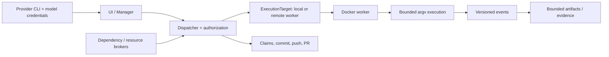

# Execution architecture v1

This document and the `src/execution` types define the shared contract for
local and remote Docker execution. The migration now includes trusted local
Engine discovery, digest-locked image selection, a hardened local backend,
durable execution records, and an SSH worker protocol/backend adapter.
The application-owned provider MCP path now connects to the shared Docker
`ExecutionSession` for repository commands. Native Linux rootless Engine
execution is the supported local path; remote scheduling and cross-platform
readiness remain subject to the release checks in the Docker security matrix.



The controller owns user approval, provider CLI and model credentials,
dependency/resource authorization, task claims, branch selection, Git
commits, pushes, and pull requests. Provider model transport remains on the
controller. The worker executes only approved repository tools and QA
commands; it never receives provider credentials, task-claim authority, Git
publication credentials, raw Docker API configuration, or a Docker socket.
A disconnected worker cannot renew a claim or publish code. A failed policy
or environment check is a denial, never permission to run a host command.

## Request and target

`ExecutionRequestV1` is a versioned JSON-compatible value. It contains
canonical execution, project, and task UUIDs; an `ExecutionTarget` and its
target ID; a `WorkspaceRef` keyed by project ID, task ID, and pinned source
SHA; one `ExecutionModeV1`; an immutable image digest; argv as an array; names
of permitted environment variables; resource limits; a deadline; QA-only
service ports; broker capability IDs; cancellation generation; and a
monotonic request sequence. The schema has no host path, credential value,
Docker socket address, raw `HostConfig`, free-form environment map, or policy
bypass field. Arguments must not include controller paths or shell command
strings.

`ExecutionTarget::Local` and `ExecutionTarget::Remote { worker_id }` select
where work runs. They do not select different security policies. The local
backend resolves `WorkspaceRef` to an operator-local path. The remote SSH
client negotiates worker protocol, version, capabilities, and policy identity;
`WorkspaceManifestV1` now validates the pinned Git `HEAD`, hashes each
included file, preserves executable bits and confined symlink targets, records
private-path exclusions, and enforces entry, depth, and byte limits. The remote
worker accepts bounded chunk transfers and verifies the staged workspace
against its source-bound manifest. The target architecture stages content
identified by the reference, never the controller's bind path. The
authoritative task clone remains the source of truth: uncommitted task changes
are staged for execution, and returned workspace changes and evidence are
verified and applied by the controller through the task-claim publication
fence. The worker does not commit, push, or merge them. Broader
two-controller/two-worker recovery acceptance remains gated in the Docker
security matrix.

## Policy

`ExecutionPolicyV1` is created by application code, not by a model. Its
filesystem grants, environment names, command and tool capabilities, service
ports, and resource limits are explicit. `network_access: disabled` maps to a
worker network-isolation mode with no interfaces. Only the explicit
`runtime_qa_service_ports` mode can reach named local service ports; an empty
port set always means networking is disabled. Every policy requires a
non-root user, prohibits host secrets and privileged mode, and limits CPU,
memory, process count, temporary storage, and output. `restrict_to` intersects
grants and lowers numeric limits. Both local and remote workers validate the
deserialized request and policy against their own supported ceiling before
execution; unknown fields or versions fail closed.

Execution mode is security authority. `HarnessRole` is a user-facing provider
role and maps deterministically to a mode; choosing a provider or role cannot
expand policy. `ProviderReadinessV1` keeps CLI binary/version, authentication,
model catalog, scriptable invocation, Docker MCP bridge, target availability,
and failure state independent. CLI probing is not tied to Docker readiness.
Providers use the same application-owned tools for every role; Codex host
tool features remain disabled and no host code mode is part of this contract.

## Backend and lifecycle

`ExecutionBackend` defines one async lifecycle for local and remote targets:
probe, prepare workspace, start, exec, read events, cancel, collect bounded
artifacts, and release. Commands are argv vectors and must be checked against
the effective policy on every execution request. There is no task-provided
Docker configuration parameter.

The lifecycle is:

```text
Queued -> Preparing -> Running -> Collecting -> Succeeded
                 \          \              \-> Failed
                  \          \-------------> Cancelled
                   \------------------------> Interrupted
```

`ExecutionEventV1` carries schema version, execution ID, contiguous sequence,
timestamp, and a typed lifecycle/output/metrics/artifact event. Stdout and
stderr chunks are capped at 64 KiB; event pages are capped at 256 entries.
Replayed events with the same sequence and identical content are deduplicated.
Reusing a sequence with different data, skipping a sequence, changing
execution ID, moving timestamps backward, or violating the lifecycle is a
protocol error. The remote caller resumes from its last accepted sequence;
the worker journals events on disk for reconnect recovery.

`ExecutionResultV1` carries exit status or signal, timeout/cancellation,
resource metrics, bounded artifact manifests, and a structured failure:
`EnvironmentUnavailable`, `PolicyDenied`, `DependencyRequired`,
`ImageUnavailable`, `WorkerDisconnected`, `WorkerIncompatible`, or
`ExecutionFailed` (plus explicit cancellation and deadline outcomes).
Artifact paths are relative, digests are checked, and artifact size is
bounded. SSH transport uses length-prefixed versioned envelopes over a fixed
host-key-verified worker command. The worker exposes only the typed execution
backend; it does not expose Docker Engine directly. Workspace and result
transfer primitives now provide bounded chunks, source-bound manifests, and
durable resume state. A controller receives a `VerifiedWorkspaceResult` only
after the complete worker manifest, task identity, source SHA, snapshot
generation, chunks, and file digests have passed validation. The remote backend
stages owned task clones, verifies returned workspace state, and applies
results through the task-claim publication fence. Automatic target selection
uses current worker health, image and policy compatibility, resource capacity,
dependency readiness, and explicit remote approval; users can still select a
specific worker or local execution.

Before execution, the controller binds the configured worker ID to a locally
enrolled SSH principal, host alias, and pinned host-key fingerprint. Health
negotiation checks protocol version, application version, compatibility, and
the execution-policy fingerprint. Each controller RPC is durably recorded
with its exact request envelope before transmission. Reconnect may resend only
that same request ID and payload; the worker's append-only journal replays a
completed response or rejects an uncertain/conflicting request without
dispatching it again. Pending outcomes remain available for reconciliation
after a controller restart.

The worker acknowledges an accepted `Exec` request before waiting for command
completion. It runs the backend operation concurrently with the stdio request
loop so the controller can subscribe to journaled events or cancel the same
execution while it is running. The SSH response reader has a finite deadline;
an unresponsive worker is reported as disconnected. Reconnect retries the
original durable request envelope only; the client never creates a new request
to repeat an uncertain command.

## Ownership

| Responsibility | Owner |
| --- | --- |
| User approval and provider/model credentials | Controller |
| Dependency and resource broker decisions | Controller |
| Task claim leases and expiry | Controller |
| Branch/commit/push/pull-request operations | Controller |
| Ephemeral processes, containers, bounded staging | Worker |
| Result/artifact verification and applying changes to task clone | Controller |

This document records the execution contract and current implementation status.
The integrated candidate routes provider MCP repository tools through Docker.
Remote scheduling, platform support, setup UX, and production release evidence
remain gated by the Docker security matrix.
# Remote dependency broker relay status

The worker can request dependency preparation through the authenticated SSH
protocol after its workspace is staged. Relay messages are bounded and bound
to the worker, task, workspace revision, execution, authorization generation,
and cancellation generation. The controller execution bridge validates that
identity, then forwards dependency metadata through the ordinary broker
socket, preserving policy evaluation, Manager approval, cancellation, and
cache preparation. The worker receives only the broker outcome; approved
cache data travels separately through the digest-verified cache transfer.
Neither the worker nor the task container receives the controller broker
socket or provider credentials.

The opt-in
`remote_docker_worker_restores_authorized_npm_cache_without_container_network`
integration test (enabled with `KOOLADE_REMOTE_DOCKER_BACKEND_INTEGRATION=1`)
exercises this flow with an SSH worker fixture; it requires Linux, the worker
binary, rootless Docker, npm, and sshd. Set `KOOLADE_REQUIRE_SSHD_E2E=1` in a
release gate so missing sshd fails instead of skipping. This test does not
establish full multi-controller authorization and recovery parity.
Confirmed-loss retry and attempt fencing are implemented in
[#278](https://github.com/zbarno/kool.ade/pull/278), but broader two-controller
takeover and recovery acceptance, complete per-worker telemetry attribution,
and GPU/display resource provisioning remain open #141 release gates; see the
[Docker security matrix](docker-security-matrix.md).
