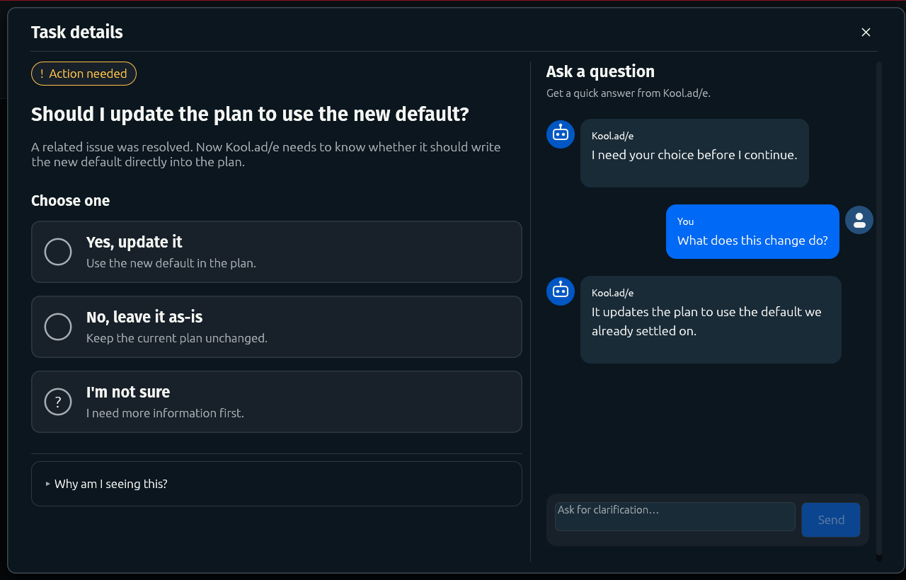
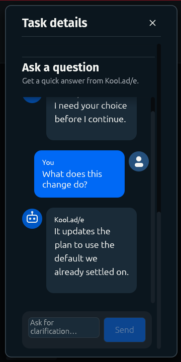

# Simplified Task Details validation

Status: all local quality gates and independent visual/interaction validation passed on the final source based on `2e79fbd7`. Native desktop manual QA remains required before merge.

The supplied mockup is the visual reference. The production modal uses a 60/40 action/conversation split at desktop widths and stacks the same content in narrow windows. Choices start unselected; the blue selected example in the reference is not a default answer.

## Coverage

| Requirement | Validation |
| --- | --- |
| Minimal action pane, cards, collapsed context and anchored composer | Production GPU gallery at 1280×820, 900×720 and 360×720; direct comparison with the supplied mockup |
| Working, completed, blocked and failed states | The same production gallery and task lifecycle tests |
| Dynamic choices, free-text answers and uncertainty | Task-details, planning-decision and clarification interaction tests |
| Questions cannot resolve decisions or apply model edits | Real command/worker/adoption tests with deliberately writable mocked responses; Git state remains unchanged |
| Answers remain bound to the current blocker | Typed answer-context, changed-blocker and legacy-history regression tests |
| Requested changes and human-step responses stay actionable | Production modal click/type/submit tests verify durable user messages and the existing mutable response routes |
| History, drafts, recovery and supporting controls remain available | Persistence, failed-save, stranded-reply, archive, cancellation, branch-details and report-scrolling tests |
| Keyboard and responsive operation | Tab/Enter activation, disabled-card tests, desktop/laptop layout tests and narrow scrolled renders |
| Established and agent-owned decisions do not become new required questions | Attention provenance/state tests and the upstream agent-owned follow-up routing regression |

New integration tests use synthetic data and mocked model responses through the production boundaries. Local Git and temporary repositories are required; no provider, SSH or Docker setup is needed. The GPU gallery requires a local wgpu adapter and several layout frames. These tests establish behavior that isolated validators cannot prove, including adoption boundaries and rendered placement.

## Required quality gates

All four gates must pass on the final source before commit:

```sh
cargo +1.98.1 fmt --all --check
cargo +1.98.1 nextest run --locked --all-targets --no-fail-fast
cargo +1.98.1 test --locked --doc
cargo +1.98.1 clippy --locked --all-targets -- -D warnings
```

All four gates passed on the final source: formatting; 3,679 nextest tests passed with 18 skipped; doc tests passed with no doc examples; and Clippy passed with warnings denied. Independent validation also passed all 78 focused tests, including the header geometry and upstream agent-owned follow-up regression.

## Visual review

Independent comparison of all eight final renders found no visual blockers. The reviewed set covers desktop action-needed, working, completed, blocked and failed states; laptop width; and narrow initial/scrolled views. Header placement, right-edge close control, typography, choice order, chat wrapping and composer reachability were checked against the supplied mockup.

Earlier failed renders exposed inherited horizontal layout, clipped controls, mismatched chat colors and title placement. Those findings were corrected and rerendered; the header now also has a regression test for left alignment and right-edge close placement.





To reproduce the gallery from the repository root:

```sh
task_home="$(mktemp -d)"
task_images="$(mktemp -d)"
KOOLADE_HOME="$task_home" KOOLADE_UI_REVIEW_DIR="$task_images" \
  cargo +1.98.1 test --locked --lib render_simplified_task_details_reference -- --ignored --nocapture
```

The gallery paints the real modal with synthetic task/conversation state and does not start AI or implementation workers. Passing its render test alone proves rendering, not fidelity; a separate visual comparison is required.

## Remaining manual validation

Native desktop manual QA is required before merge: open tasks in each state, use mouse and keyboard to answer and clarify, resize the window, and confirm that focus, scrolling and submission feedback behave normally in the native window.

This validation does not establish live-provider behavior, Docker/rootless execution or OS-specific accessibility behavior. Opt-in integration paths require their own configured environment; a passing default test suite does not establish those paths.
